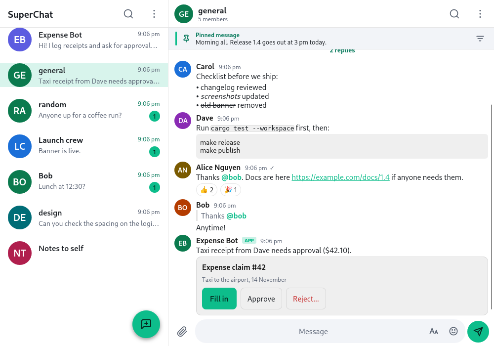
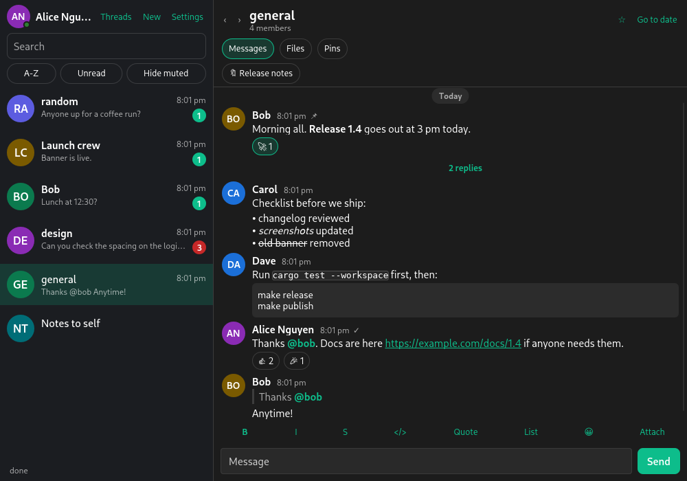
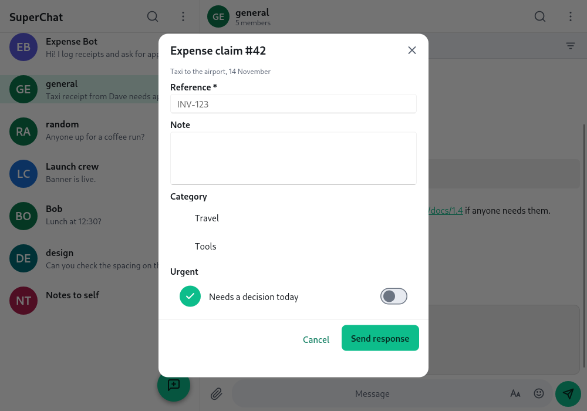
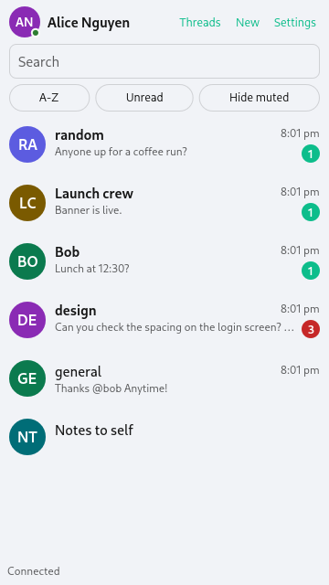
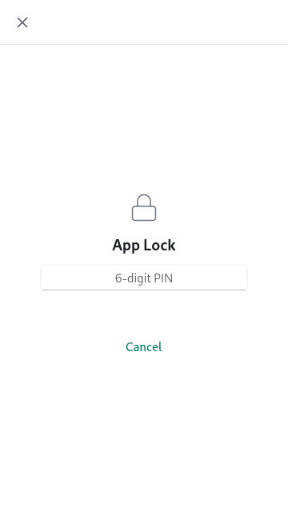
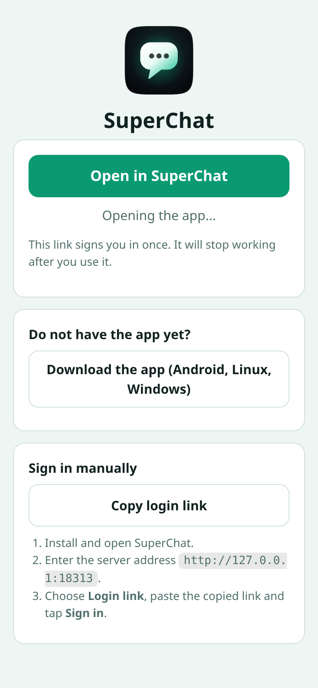

# SuperChat

_SuperChat was called Atomic Chat up to v1.0 (see "Upgrading from Atomic Chat 1.0" in [docs/DEPLOY.md](docs/DEPLOY.md))._

A self-hosted, Slack-style team chat. One small Rust server (Docker), an admin web panel, and native apps for Linux, Windows and
Android (one Slint UI shared by all three), plus a command-line client. Your data stays on your server and in the storage you choose
(S3, Cloudflare R2, Backblaze B2, MinIO or Google Drive).

* Accounts are created by an admin only (with a one-time login link you can tap, scan or paste). No public sign-up.
* Channels and group chats are private to their members. Direct messages and notes to yourself are created on demand.
* No end-to-end encryption: TLS in transit, and admins can read messages (needed for the admin chat viewer and search). Backups are
  encrypted with a passphrase.
* Bots and automation: Telegram-style bot API, webhooks, interactive forms, scheduled messages, optional AI search and recaps.
* New in 1.1.2: self-service Sign out / Sign out of all devices exist only for users whose admin set Privacy options to Allow (see [docs/RELEASE-NOTES-v1.1.2.md](docs/RELEASE-NOTES-v1.1.2.md)).
* New in 1.1: tap-to-sign-in links with a QR code, several AI providers, App Lock (PIN-hidden conversations), a phone-friendly admin panel. See [docs/RELEASE-NOTES-v1.1.md](docs/RELEASE-NOTES-v1.1.md). Calls (voice/video) are still planned.



| | | |
|---|---|---|
|  |  |  |
|  |  |  |

## Quick start (server)

```sh
git clone https://github.com/uri-travoski/superchat && cd superchat/deploy
cp .env.example .env            # set ATOMIC_PUBLIC_URL
docker-compose up -d            # or: docker compose up -d
```

Open `http://<host>:8080/admin` and complete the setup wizard (owner account, attachment storage). Images are published to
`ghcr.io/uri-travoski/superchat-server` on each release; `docker-compose.yml` builds from source if you prefer.

| Situation | What to do |
|---|---|
| **A domain** | `.env`: `ATOMIC_HOST=chat.example.com`, `ATOMIC_PUBLIC_URL=https://chat.example.com`; run `docker compose --profile caddy up -d`. Caddy gets a certificate automatically (ports 80 and 443 open). |
| **A bare IP, no domain** | `.env`: `ATOMIC_HOST=203.0.113.7`, `CADDY_TLS=tls internal`, `ATOMIC_PUBLIC_URL=https://203.0.113.7`; `--profile caddy`. Apps pin the certificate on first use (trust on first use) and warn if it changes. |
| **Cloudflare Tunnel (no open ports)** | `.env`: `CLOUDFLARE_TUNNEL_TOKEN=...`; run `--profile tunnel`, and point the tunnel hostname at `http://superchat:8080`. |

More in [docs/DEPLOY.md](docs/DEPLOY.md), admin guide in [docs/ADMIN.md](docs/ADMIN.md), bots in [docs/BOTS.md](docs/BOTS.md), the
HTTP API in [docs/API.md](docs/API.md).

## Download the apps

From the [Releases](https://github.com/uri-travoski/superchat/releases) page: Linux AppImage and `.deb`, Windows portable `.exe` and
installer, Android APK. Sign in with the server address and the username/password (or one-time link) your admin gave you.

## Features

Status: **tested** = automated test; **done** = built and checked by hand; **partial** = see notes; **not built**.
Full per-item notes are in [STATUS.md](STATUS.md).

| IDs | Feature | Status |
|---|---|---|
| SV-01..SV-07, SV-14 | Accounts, auth and sessions, conversations, message store, edit rule, realtime, attachments, roles | tested |
| SV-08, SV-09 | Search with filters, threads | tested |
| SV-10 | Scheduled messages (survive restarts) | tested |
| SV-11, SV-12 | User groups (`@handle`), favourites/sections/mute/notify level | tested |
| SV-13 | Push: content-free wake-ups via ntfy, FCM, APNs | tested with fakes only |
| SV-15, A-05 | Bots, Telegram-style and native bearer-token API | tested |
| SV-16, A-01, A-02 | Incoming and outgoing (signed, retried) webhooks | tested |
| SV-17, WF-01, A-03, A-04 | Forms (card and modal), bot App Home | tested (server, core); UI done |
| SV-19 | Admin panel: users, conversations, storage, sessions, backups, chat viewer, bots, webhooks, AI, groups, bookmarks | done, Playwright |
| SV-20, AD-06 | Encrypted backups, restore onto a new server, selective restore | tested |
| SV-21, SR-07 | AI search and recap (off by default; text goes to the provider) | tested with a fake provider |
| SV-22 | Docker image, compose profiles (Caddy, Cloudflare Tunnel, ntfy, MinIO) | done |
| SV-24 | End-to-end suite (docker server, MinIO, fake Google Drive, fake ntfy, bots, webhooks, restart) | tested |
| SV-18, CL-01 | Voice/video calls | not built (v1.1) |
| X-01..X-08 | Login, TLS fingerprint pinning, secret storage, sync, offline cache, forced sign-out, emoji picker | done (see limits) |
| M-01..M-13, M-16, M-25..M-29, M-32 | Messaging: DMs, channels, edit/delete, reactions, formatting, mentions, unread, offline outbox | tested + done |
| M-20..M-24 | Forward, quote, drafts, drafts and sent view, schedule send | done |
| M-30, M-31 | Voice messages (record on Android and Linux with `arecord`, inline audio player), video clips (upload, opens system player) | partial |
| C-07, C-09 | Bookmarks (add in the apps and the admin panel), pins | done |
| NV-01..NV-09, SR-01..SR-06 | Switcher, history, sections, search filters, recent and saved searches | done |
| F-01..F-03 | File upload, drag-and-drop (X11/Windows), paste image, previews | partial |
| N-01, N-02 | Android ntfy and FCM wake-ups with local notifications; desktop notifications | partial (ntfy done; FCM compiled in only with a Firebase config) |
| E-01..E-08 | Themes, compact, font size, 12/24 h, share target (Android), launch on login, tray icon | done / partial |
| P-01..P-05 | Presence, DND, profile | done (auto-away missing) |

## Build from source

Needs Rust (stable), Node 22, and for Android the Android SDK + NDK 27, `cargo-ndk`.

```sh
cargo test --workspace                          # unit and integration tests
(cd admin-web && npm ci && npm run build)       # admin panel
cargo build --release -p atomic-server          # server (serves admin-web/dist via ATOMIC_ADMIN_DIR)
cargo build --release -p atomic-desktop         # desktop app: target/release/superchat
tests/e2e/run.sh                                # end-to-end suite (needs docker)
tests/ui/screenshots.sh                         # screenshots (private Xvfb, never your desktop)
```

Packages (output in `dist/`):

```sh
cargo install cargo-deb && cargo deb -p atomic-desktop --output dist/     # .deb
packaging/linux/build-appimage.sh                                         # AppImage
(cd apps/android && ./gradlew assembleRelease)                            # APK (arm64-v8a + x86_64)
docker build -f deploy/Dockerfile -t superchat:1.1.2 .                    # server image
```

Windows (`.exe` and NSIS installer) and the published images are built by `.github/workflows/release.yml` when a `v*` tag is pushed.
Android release signing: set `ANDROID_KEYSTORE_BASE64`, `ANDROID_KEYSTORE_PASSWORD`, `ANDROID_KEY_ALIAS`, `ANDROID_KEY_PASSWORD` as repository secrets;
without them CI signs with a throw-away key (installs fine, but cannot update an install signed with another key).

## Layout

`crates/proto` (API types, schema), `crates/server`, `crates/client-core` (all client logic), `crates/cli`, `apps/desktop` (Slint UI, also used
by Android), `apps/android` (Kotlin shell + Rust cdylib), `admin-web` (TypeScript), `deploy`, `packaging`, `tests`, `docs`.

## Licence

MIT, see [LICENSE](LICENSE). Colour emoji pictures come from Noto Color Emoji (SIL Open Font License 1.1). The UI uses
[Slint](https://slint.dev) under its royalty-free licence terms for desktop, mobile and web apps.
